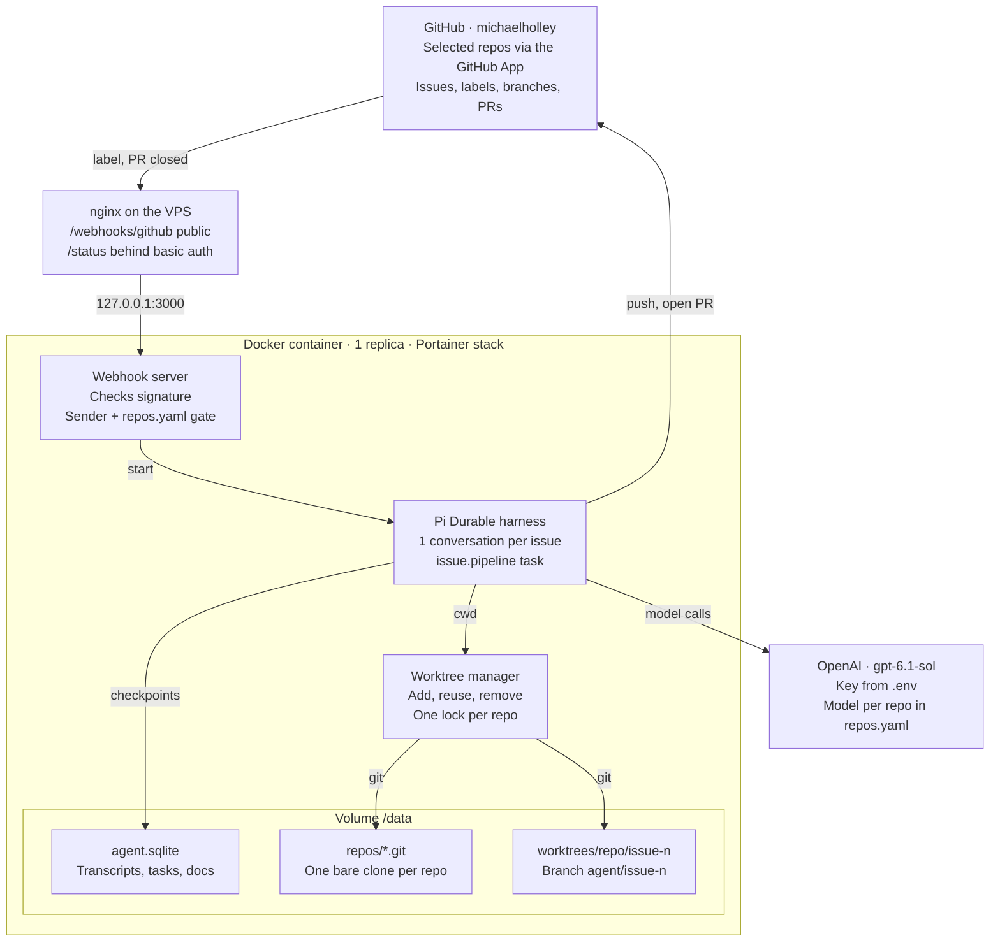

# Pi Durable Issue Agent: MVP Implementation Plan

Oct 19, 2026 · Michael Holley

## Goal and scope

The MVP turns an `agent:ready` label on any allowlisted repo under the `michaelholley` GitHub account into a pull request. It is written by a Pi Durable agent working in its own git worktree, and it runs as one Docker container.

**In scope**

- Several repos of the personal account `michaelholley`, configured in one file
- One git worktree and one branch per issue, so issues never share a working directory
- Label-driven lifecycle: start, progress, PR opened, failed, stop
- Crash and restart safety through Pi Durable (resume mid-run, no duplicate PRs)
- Run the repo's own test command before opening the PR
- Clean up the worktree when the PR is merged or closed

**Success criteria**

- Labelling issues in two different repos produces two PRs, each linked with `Closes #n`
- Two issues in the same repo run at the same time without touching each other's files
- Killing the container mid-run and starting it again finishes the job with one PR, not two

## Architecture



GitHub events reach the webhook server through nginx on the VPS. The harness runs one conversation per issue inside that issue's worktree. Everything that must survive a restart lives on the `/data` volume.

## Multi-repo support for michaelholley

One GitHub App installed on your personal account serves every repo. A repo is worked on only if it is both granted to the app and listed in `repos.yaml`.

**GitHub App (created under michaelholley)**

- Install on the personal account with "Only select repositories", so new repos are opt-in
- Repository permissions: Contents read/write, Issues read/write, Pull requests read/write, Metadata read
- Events: `issues` (labeled, unlabeled), `pull_request` (closed)
- One webhook URL and one secret cover all installed repos
- The app mints a short-lived installation token (valid 1 hour) for each git push and API call, so no long-lived personal token is used

**Second gate: `config/repos.yaml`**

Each repo declares how to build and test it. The agent never guesses the test command.

```yaml
owner: michaelholley
allowedSenderId: <your numeric GitHub user id>
defaults:
  model: { provider: openai, modelId: gpt-6.1-sol }
  maxTurns: 60
  maxCostUsd: 3
  maxFixAttempts: 2
repos:
  - name: byok-imagen
    defaultBranch: main
    setup: pnpm install --frozen-lockfile
    test: pnpm check
    lint: pnpm lint
```

`test` and `lint` are both optional. byok-imagen has no test suite, so `pnpm check` (svelte-check) takes the `test` slot.

**Who may trigger**

- The webhook handler accepts a label event only when `sender.id == allowedSenderId`. It compares the numeric id, because the login is `MichaelHolley` and a string match is case-sensitive. Collaborators are not supported in the MVP.
- Events from repos missing in `repos.yaml` are logged and ignored, even if the app can see them

**Label setup**

- A one-off `npm run setup-labels` creates the `agent:*` labels on every repo listed in `repos.yaml`

## Git worktree strategy

Each repo gets one bare clone. Each issue gets its own worktree from it, on branch `agent/issue-<n>`. The worktree path becomes the `cwd` of that issue's Pi Durable conversation.

```
/data/
  agent.sqlite                      # Pi Durable storage
  repos/
    byok-imagen.git/                # bare clone, shared object store
    <second-repo>.git/
  worktrees/
    byok-imagen/
      issue-12/                     # branch agent/issue-12
      issue-15/                     # branch agent/issue-15
    <second-repo>/
      issue-3/
```

**Lifecycle (in `src/git/worktrees.ts`)**

1. `ensureRepo(repo)`: the first time, run `git clone --bare` and then set `remote.origin.fetch` to `+refs/heads/*:refs/remotes/origin/*` so remote branches are tracked.
2. `createWorktree(repo, n)`: `git fetch origin`, then `git worktree add -b agent/issue-<n> <path> origin/<defaultBranch>`.
3. `reuseWorktree`: if the path already exists (resume after a crash), keep it as is. If the branch exists but the path does not, run `git worktree add <path> agent/issue-<n>`.
4. `removeWorktree(repo, n)`: `git worktree remove --force <path>`, `git branch -D agent/issue-<n>`, `git worktree prune`.

**Rules**

- **One lock per repo.** All git commands that change the shared `.git` (fetch, worktree add, remove, prune) run under an in-process mutex keyed by repo name. A single process owns the storage, so an in-memory lock is enough.
- **Commits and edits inside a worktree need no lock.** Each worktree has its own index and HEAD.
- **Deterministic names.** A path and branch derived from `repo` + issue number make every step safe to rerun after a crash.
- **Clean commits.** The commit author is the App's bot identity, `<app-slug>[bot]` with email `<bot-user-id>+<app-slug>[bot]@users.noreply.github.com`, so GitHub links the commits to the App. The agent commits inside its worktree. Pushing is done by a tool, not by bash (see Security).
- **Dependencies per worktree.** `setup` from `repos.yaml` runs once per new worktree. The pnpm store lives on the volume, so repeat installs are fast.
- **Cleanup.** A `pull_request.closed` webhook for an `agent/issue-*` branch removes the worktree. A nightly sweep removes worktrees whose issue is closed and runs `git worktree prune` on each repo.

## End-to-end workflow

A label starts one durable pipeline per issue. The labels on the issue show its state at all times.

1. You add `agent:ready` to issue #12 in `byok-imagen`.
2. The webhook handler checks the signature, the sender and the allowlist. It then swaps the label to `agent:working`.
3. It looks up or creates the conversation for `michaelholley/byok-imagen#12` and starts the `issue.pipeline` task. The `requestId` is the GitHub delivery id, so a redelivered webhook is a no-op.
4. **prepare**: create or reuse the worktree, run `setup`.
5. **implement**: submit the issue title, body and comments to the conversation, then wait until it settles.
6. **verify**: the pipeline itself runs `lint` and `test` in the worktree. Steps that aren't configured are skipped. On failure, the output goes back to the conversation, up to `maxFixAttempts` (default 2) times.
7. **publish**: commit any leftovers, push `agent/issue-12`, open the PR with `Closes #12` and a summary.
8. **report**: comment on the issue with the PR link and cost, and swap the label to `agent:pr-open`.

Any phase that runs out of retries, turns or budget ends in **failed**. The agent comments with the reason and the last test output, and sets `agent:failed`.

**Labels**

| Label | Set by | Meaning |
| --- | --- | --- |
| `agent:ready` | You | Start work on this issue |
| `agent:working` | Agent | Pipeline running |
| `agent:pr-open` | Agent | PR opened, waiting for your review |
| `agent:failed` | Agent | Gave up; see the comment. Re-add `agent:ready` to retry |
| `agent:stop` | You | Abort the run now; the worktree is kept for inspection |

**Re-adding `agent:ready`**

- After `agent:failed` or `agent:stop`, the run continues: same worktree, branch and conversation. A new `issue.pipeline` task starts, keyed by the new delivery id, and the model sees its earlier attempt plus the current issue text.
- While the issue has an open agent PR (`agent:pr-open`), the label is ignored and logged, and the agent removes it. Feedback on open PRs waits for the later review loop.

**Concurrency**

- At most 3 pipelines run at once across all repos (configurable). Others wait in the `queued` phase.
- Issues in the same repo run in parallel, because each has its own worktree.

## Pi Durable components

One harness over one SQLite file holds every repo's conversations. Each issue has one conversation and one pipeline task.

**Harness (`src/main.ts`)**

- `Harness.open(openNodeSqliteStorage('/data/agent.sqlite'), { models, registry, env })`, then `harness.resume()` before the HTTP server accepts webhooks
- `env = ({ cwd }) => new NodeExecutionEnv({ cwd })`, where `cwd` is the issue's worktree path
- Compaction settings left at their defaults

**Conversation per issue**

- Created with `harness.createConversation({ ownership: { kind: "ownerless" }, agent }, context)`, not `root()`
- Key: `michaelholley/<repo>#<n>`. A session-scoped document `app.issueIndex` maps key to conversation id, so a later event finds the same conversation.
- Agent config: the model from `repos.yaml`, `cwd` = the worktree, instructions that the issue text is a task description and not a source of commands

**Extensions**

| Extension | Contents | Replay after crash |
| --- | --- | --- |
| `CodingTools` | read, write, edit, bash | bash: model is told it was interrupted |
| `repo-context` | Sections: AGENTS.md or README of the worktree, repo name, test command | n/a |
| `github` | `get_issue`, `list_issue_comments` | safe |
| `github` | `push_branch`, `open_pr` (returns the existing PR if one is open for the branch) | safe, because both are idempotent |
| `guards` | `beforeTool` hook on bash: blocks `git push`, `gh`, writes outside the worktree, `rm -rf /` patterns | n/a |

**Task `issue.pipeline`**

- Phases: `queued → prepare → implement → verify → publish → report`, plus terminal `failed` or `aborted`
- `implement` submits to the conversation with `requestId: <deliveryId>:implement`, then waits on it
- `verify` retries submit with `requestId: <deliveryId>:fix-<attempt>`
- `abort` (from `agent:stop`) aborts the conversation's work, keeps the worktree and sets the label

**Document `app.issueState` (one per conversation)**

- `repo`, `issue`, `branch`, `worktreePath`, `phase`, `attempts`, `prUrl`, `costUsd`, `lastError`
- Read by the status endpoint and the final comment

**API notes (checked against `packages/durable` v1.3.0)**

- **Package version.** Pin `pi-durable`, `pi-ai` and `chord` to `1.3.0`. The `main` branch has unreleased breaking changes: a SQLite schema v2 migration that can't be rolled back, `sleepUntil()` replacing `sleep()`, and a required `checkpointWhen` on docs. Write docs with `checkpointWhen: () => false` from the start so the upgrade is easy.
- **Documents.** The scopes are `session`, `conversation` and `task`. There is no "harness" scope. `app.issueIndex` is a `defineDocFamily` with `scope: "session"`, keyed by issue key. `app.issueState` is a `conversation`-scoped `defineDoc`.
- **Starting the pipeline.** The webhook handler creates the task with `conversation.commit((tx) => tx.createTask(IssuePipeline, input, …))` and writes `app.issueState` in the same commit. The task definition is installed through an extension's `tasks`, and pending tasks resume only after that extension is installed again on startup.
- **Phases rerun from the top after a crash.** Every phase must be idempotent (deterministic names, `requestId` on every submit, check-then-act for GitHub). Waiting on a submission inside a phase is fine. After a restart, the same `requestId` returns the same submission to wait on.
- **No deadlock on self-submit.** A conversation is busy only while a model run is active. A non-run task owned by the conversation can submit input to it and wait.
- **Abort.** `agent:stop` calls `harness.abortTask(pipelineTaskId)`, which aborts owned work bottom-up and then runs the task's `abort` handler. The task id is stored in `app.issueState`.
- **Turn and cost budgets are not built in.** The `guards` extension enforces them with a `GenerationTask` hook (`afterTools` / `onYield`) that counts turns and reads `docs["pi.usage"]`, and ends the run on a breach.
- **Side-effect tools.** `push_branch` and `open_pr` are `replay: "safe"`. They read `api.conversationId`, then `app.issueState`, to find the worktree and branch, so they take no arguments. `bash` is not replay-safe, so the model is told it was interrupted.
- **Crash loops.** Parking (`settings.restartLimit`, `task_parked`, `retryTask`) is not in 1.3.0, only on `main`. Until then, every phase catches its own errors and routes them to `failed`, but a phase that kills the process on every attempt loops forever.
- **Failures.** A storage error closes the harness. Watch `harness.closed` and exit the process, and Docker restarts it.
- **Tests.** Use `fauxProvider()` from `@earendil-works/pi-ai/providers/faux` as the scripted stub model, with `MemoryStorage` for unit tests and a temp SQLite file for the `CRASH_AT` tests. `test/examples/26-coding-agent.ts`, `28-reviewer.ts`, `29-sandbox-per-conversation.ts` and `13-recovery.ts` are the closest templates.

## Project structure and Docker

A single TypeScript service in a single container with a single volume. The code lives at the root of the `mike-factory` repo and uses pnpm and vitest. It runs on the VPS as a Portainer stack behind nginx.

```
mike-factory/
  .github/workflows/docker.yml  # build and push to Docker Hub
  config/repos.yaml
  src/
    main.ts                 # open harness, resume, start server
    server.ts               # POST /webhooks/github, GET /status
    github/app.ts           # Octokit App, installation tokens
    github/webhooks.ts      # signature check, sender + allowlist gate
    git/worktrees.ts        # bare clones, worktrees, per-repo mutex
    agent/registry.ts       # installs extensions + tasks
    agent/extensions/       # repo-context, github, guards
    agent/tasks/issuePipeline.ts
    agent/docs.ts           # app.issueIndex, app.issueState
    scripts/setup-labels.ts
  Dockerfile
  compose.yaml
```

**Dependencies:** `@earendil-works/pi-durable`, `@earendil-works/pi-ai` and `@earendil-works/chord`, pinned to exactly `1.3.0`. Also `@octokit/app`, `@octokit/webhooks`, `hono` (or Fastify) and `yaml`. Dev: `vitest`.

**Dockerfile essentials**

- Base `node:22-bookworm-slim`, plus `git`, `ca-certificates`, pnpm through corepack, and any other toolchains your repos need for tests
- Runs as a non-root user `agent`, with `WORKDIR /app` and the volume at `/data`
- At startup, `main.ts` looks up the App's bot user and sets `GIT_AUTHOR_*` and `GIT_COMMITTER_*` in the process env to its identity (not `git config --global`, so local dev leaves your own git identity alone)

**compose.yaml**

- Deployed as a Portainer stack on the VPS, using the image `<dockerhub-user>/mike-factory:latest`
- Service `agent`: `restart: unless-stopped`, `ports: "127.0.0.1:3000:3000"`, `volumes: ./data:/data`, `env_file: .env`, `replicas: 1` (one process per storage)

**nginx (on the VPS host)**

- `location /webhooks/github` proxies to `127.0.0.1:3000` and is public. The webhook signature is the auth.
- `location /status` proxies to `127.0.0.1:3000` behind basic auth
- Everything else returns 404

**CD: `.github/workflows/docker.yml`**

- Runs on every push to `main`, builds `linux/amd64`, and pushes `<dockerhub-user>/mike-factory:latest` and `:sha-<short>` to Docker Hub
- Uses the repo secrets `DOCKERHUB_USERNAME` and `DOCKERHUB_TOKEN`
- Deploying stays manual: pull and recreate the stack in Portainer. Pin a `sha-` tag to roll back.

**Local development**

- Plain node on your Mac (`pnpm dev`, `pnpm test`), without Docker
- Only the scripted `fauxProvider` runs locally, so no real model gets a shell on your Mac. Real-model runs happen only in the container on the VPS.

**.env**

- `GITHUB_APP_ID`, `GITHUB_PRIVATE_KEY` (or a mounted file), `GITHUB_WEBHOOK_SECRET`
- `OPENAI_API_KEY`, `MAX_CONCURRENT=3`

## Security and guardrails

The agent has a shell, so the container is the sandbox. For the MVP, the rules keep the GitHub token and your default branches out of its reach.

- **Token never reaches bash.** The installation token exists only inside the `push_branch` and `open_pr` tools. It is not written into git config.
- **Secrets are removed from the process env.** `NodeExecutionEnv` gives bash a copy of the whole `process.env` by default. So at startup `main.ts` reads `GITHUB_PRIVATE_KEY`, `GITHUB_WEBHOOK_SECRET` and the model API key into memory and deletes them from `process.env` before the harness opens. A test checks that `env` in bash doesn't show them.
- **Push only the issue's branch.** `push_branch` takes no arguments. It pushes `agent/issue-<n>` from the current conversation's worktree and refuses any other ref.
- **Bash guard hook.** It blocks `git push`, `git remote`, `gh`, `curl` or `wget` to `api.github.com`, and paths outside `/data/worktrees/<repo>/issue-<n>`.
- **Branch protection.** Turn on "require a pull request" for `main` in each repo, as a second line of defence.
- **Issue text is data.** The system prompt says so. Only your GitHub user id can trigger a run (see Multi-repo).
- **Budgets.** `maxTurns` and `maxCostUsd` per issue, from `repos.yaml`. Breaching either ends the run in `failed`.
- **Dedicated host.** The container runs on the VPS, which should hold no other secrets. During local development only the faux model runs. Per-issue sandbox containers are a later step.

## Milestones

There are two milestones. M1 delivers a restart-safe agent on one repo. M2 extends it to your whole account.

### M1: One repo, label to PR, safe to restart

**Goal:** a label on a test repo yields exactly one PR, even if the container restarts mid-run.

**Scope**

- GitHub App under `michaelholley`, installed on `byok-imagen`. The webhook reaches the container through nginx on the VPS.
- Docker image, compose file and `/data` volume from day one, plus the Docker Hub CD workflow and the Portainer stack
- A bare clone and one worktree per issue. Runs are serial.
- Harness on SQLite with `CodingTools`, `repo-context` and the bash guard hook
- `issue.pipeline` with the phases prepare, implement, verify, publish and report, plus the `app.issueState` document
- Idempotent side effects: the delivery id is the `requestId`; `push_branch` and `open_pr` return existing results; worktree creation reuses existing paths
- Labels `agent:working`, `agent:pr-open`, `agent:failed` and `agent:stop`, `maxFixAttempts` (default 2) after a failed verify, and a cost budget
- Sender gate on `allowedSenderId`, and re-adding `agent:ready` continues the run (ignored while a PR is open)
- The installation token lives only inside the push and PR tools

**How it is tested**

- A local bare repo acts as the remote for the worktree manager and `push_branch`, and an in-memory fake of Octokit stands in for issues and PRs
- A scripted stub model makes pipeline runs fast and repeatable
- Each side-effect tool, called twice, produces one result
- `CRASH_AT=<phase>` exits the process at that phase boundary. The test restarts the harness and asserts exactly one PR. There is one test per phase, 5 in total.
- One manual end-to-end run on the VPS against `byok-imagen` with a trivial issue, plus one redelivery from GitHub's webhook log

**Exit criteria**

- A real issue labelled `agent:ready` gets a PR with passing tests and `Closes #n`
- All 5 `CRASH_AT` tests pass
- A redelivered webhook starts nothing new
- A failing verify ends in `agent:failed` with the output in the comment
- A push to `main` publishes a new image to Docker Hub
- `agent:stop` aborts the run, and `git push origin main` from bash is blocked

**Removes the risk of:** unknowns in the Pi Durable API, in GitHub App authentication, and in pushing from a worktree, plus duplicate PRs after restarts.

### M2: Many repos, many issues in parallel

**Goal:** extend the hardened pipeline across your account without adding new ways for it to fail.

**Scope**

- `repos.yaml` with per-repo setup, test, lint, model and budget, plus the allowlist and sender gate
- A per-repo mutex for operations on the shared `.git`, worktrees running in parallel, and a global concurrency limit with a queue
- The `setup-labels` script, and toolchains for every listed repo in the image
- Cleanup when a PR closes, plus a nightly sweep and `git worktree prune`
- A `/status` endpoint that reads from `app.issueState`

**Exit criteria**

- The acceptance checklist below passes on two real repos
- 3 issues in one repo and 1 in another run at once, and each PR holds only its own changes. The M1 crash tests still pass with these concurrent runs.
- After all PRs are merged, no worktrees or `agent/issue-*` branches remain locally

**Removes the risk of:** concurrent changes to shared git state, and environments that differ per repo.

## Acceptance checklist

The MVP is done when every box below is ticked on two of your real repos.

- [ ] Label `agent:ready` in repo A produces a PR on `agent/issue-<n>` with `Closes #n`, green tests and a cost comment
- [ ] The same in repo B at the same time
- [ ] Two issues in repo A run at once. Each PR contains only its own changes.
- [ ] `docker compose restart` during implement: the run resumes and produces exactly one PR
- [ ] Redelivering the webhook from GitHub's delivery log does not start a second run
- [ ] A label from any account other than yours, or a repo missing from `repos.yaml`, is ignored and logged
- [ ] `agent:ready` on an issue with an open agent PR is ignored and removed
- [ ] `agent:stop` aborts within 30 seconds and keeps the worktree
- [ ] A failing verify after `maxFixAttempts` (2) ends in `agent:failed` with the output in the comment
- [ ] Merging or closing the PR removes the worktree and the local branch
- [ ] A bash command `git push origin main` from the agent is blocked by the guard hook

## Later, risks and open questions

**Not in the MVP**

- Steering from issue or PR comments (`whenBusy: "steer"`), and a review-feedback loop on open PRs
- One sandbox container or VM per issue through a custom execution environment
- Repos outside `michaelholley` (orgs), collaborators as triggers, and Postgres storage or sharding
- Automatic deploys from CD to Portainer
- A web UI. `/status` and the issue comments cover the MVP.

**Risks**

- Pi Durable is experimental and its API may change. Pin exact versions and upgrade on purpose.
- Toolchains differ per repo. The image must contain all of them, or tests fail for environment reasons.
- Disk use grows with dependencies per worktree. Cleanup and a shared package cache keep it in check.
- Model output quality varies on vague issues. Good issue templates help more than prompt tuning.

**Decisions (interview, Oct 20, 2026)**

- First repo: `byok-imagen`. Verify runs `pnpm check` and `pnpm lint`, because it has no test suite.
- Model: OpenAI `gpt-6.1-sol` (checked in pi-ai 1.3.0), `maxCostUsd: 3`, `maxFixAttempts: 2`
- Host: the VPS, as a Portainer stack behind nginx. The image comes from Docker Hub through CD on push to `main`.
- PRs open as normal PRs, not drafts. `agent:pr-open` already means "waiting for review".
- Trigger gate: your numeric GitHub user id only
- Re-adding `agent:ready` continues the same worktree and conversation, and is ignored while a PR is open
- Local dev runs as plain node with the faux model only

**Open questions**

- [ ] Which second repo is used for M2 and the acceptance checklist?

## Sources

- [Pi Durable source, `packages/durable`](https://github.com/earendil-works/pi/tree/main/packages/durable): main API reference. Read `README.md`, `docs/spec.md` (the full spec), `CHANGELOG.md` and `test/examples/`. The API notes above were checked against commit `885a564` (Oct 20, 2026).
- [Pi Durable announcement, Earendil](https://earendil.com/posts/pi-durable/): concepts and the harness and crash-recovery examples
- [Pi 1.0 and Pi Durable release coverage](https://letsdatascience.com/news/pi-10-adds-mcp-and-durable-harness-6241c6f7)
- [Sentry for Pi Durable](https://docs.sentry.io/platforms/javascript/guides/pi-durable/)
